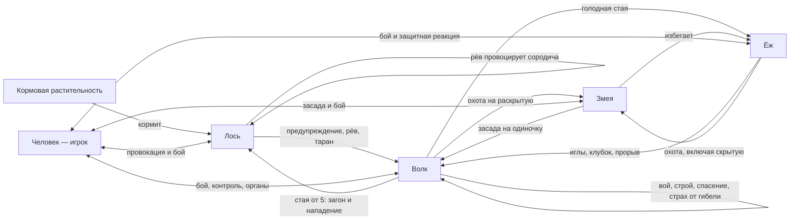

# Чистые виды CHIMERA: ресурсы, бой, чувства, психики и экосистема

26.10.2026 · дизайн-линия Codex · **фактический аудит и материал для обсуждения баланса**.

Не принятая спека, не новые правила и не поручение менять числа. Сохранение разбора из чата по просьбе геймдизайнера. Код, данные и действующие спеки этой поставкой не менялись.

## 1. Границы и воспроизводимость

Цель: сравнить игровые ресурсы всех реализованных чистых видов, межвидовые и внутривидовые отношения, психики и экологические роли; отделить реализацию от описаний и предложений.

- Срез: `ChimeraEvolution-codex`, HEAD **c7131e5**, локальный main **52d73f6**. Проверены сохранённые ассеты, префабы, исходники и настройки `SampleScene`. Различия ветки с main в проверенном наборе затрагивали модельную сборку; механики, на которые опираются таблицы, совпадали.
- Проверка статическая. **Unity, боевые симуляции и плейтест не запускались.** Расчёт характеристик не доказывает исход конкретного боя или подключение каждого механизма в каждом лесном стенде.
- **Факт** — сохранённое значение или найденный исполняемый путь. **Расчёт** — результат формулы при явно заданных условиях. **Вывод** — интерпретация для обсуждения, не решение геймдизайнера.
- Чистые реализованные виды: человек, волк, лось, ёж, змея. Для филина полноценного числового профиля и психики в исследованном срезе нет. Виды других биомов не включены как реализованные.
- Человек ниже — игрок; звери — обычные NPC. Это **не одинаковый уровень мощности**: собственные органы чистого человека работают при родстве 100 с множителем ×2; экспрессия волка в префабе 0,45, остальных зверей 0,5.
- Не включены предметное оружие, боссовые конфигурации, смешанные составы и награды метапрогрессии как параметры чистого вида. Предмет в руках может заменить параметры обычного удара человека.
- Старые паспорта и комментарии не подменяют ассеты и операции кода. Обнаруженные расхождения вынесены в §10.

Связанный документ: [десять направлений развития леса](FEEDBACK-2026-10-25e-codex-les-roadmap-predlozhenie.md). Там предложения по среде; здесь фактическая база сравнения видов.

## 2. Ресурсы и движение

**Расчёт:** полный родной состав, без голода, ярости, погоды, боссовости и индивидуального разброса. Скорости в м/с, реген — единицы/с.

| Параметр | Человек, игрок | Волк, NPC | Лось, NPC | Ёж, NPC | Змея, NPC |
|---|---:|---:|---:|---:|---:|
| Масса вида, кг | 80 | 90 | 440 | 12 | 66 |
| Пул мутагена | 16 | 16 | 24 | 18 | 20 |
| Экспрессия собственных органов | 2 | 0,45 | 0,5 | 0,5 | 0,5 |
| База HP шасси | 75 | 38 | 70 | 52 | 60 |
| Итоговый максимум HP | 150 | 68 | 140 | 83 | ≈100 |
| Стамина | 200 | 85,75 | 182 | 72 | 63,25 |
| Восстановление стамины/с | 28 | 10,0125 | 5 | 9,2 | 7,7 |
| Обычный ход | 9 | 4,05 | 2,5 | 3 | 5 |
| Постоянный реген HP/с | 0 | 1,35 | 0,5 | 0,25 | 0 |
| Дополнительный реген вне боя | 1,5 | 0 | 0 | 0 | 1 |
| Снижение урона кожей | 0% | 13,5% | 17,5% | 10% | 12,5% |
| Особая защита | — | — | Кровеупорность, Massive | Ядоупорность, ответные иглы, клубок | Камуфляж, холоднокровность |

HP змеи до округления — 100,5. HP округляет `Mathf.RoundToInt`. Формулы:

```text
HP = Round(база шасси × (1 + бонус сердца × экспрессия) × разброс × боссовость)
Стамина = база стамины × (1 + бонус стамины сердца × экспрессия)
Реген стамины = базовый реген × (1 + бонус регена сердца × экспрессия)
```

Бонусы родного сердца в ассете:

| Вид | База стамины / регена | Бонус HP | Бонус стамины | Бонус регена стамины |
|---|---|---:|---:|---:|
| Человек | 100 / 14 | 0,5 | 0,5 | 0,5 |
| Волк | 70 / 9 | 1,75 | 0,5 | 0,25 |
| Лось | 140 / 5 | 2 | 0,6 | 0 |
| Ёж | 60 / 8 | 1,2 | 0,4 | 0,3 |
| Змея | 55 / 7 | 1,35 | 0,3 | 0,2 |

Масса не пересчитывает HP автоматически. Поэтому человек на своей мощности сейчас имеет больше HP, чем обычный лось. При включённой индивидуальности NPC получают разброс HP и урона ±15%, скорости ±10%. В сохранённой `SampleScene` индивидуальность выключена.

| Вид | Дополнительные режимы движения |
|---|---|
| Человек | Бег ×1,6 = 14,4; тихий шаг ×0,4 = 3,6. Рывок 30, длительность 0,18 с, откат 0,7 с, цена 25 стамины |
| Волк | Брожение на половине скорости; прыжок: скорость 13, применение на 5–6,5 м, цена 30 |
| Лось | Кормёжка/подход на половине скорости; таран: скорость 35, применение на 4–18 м, цена 70 |
| Ёж | Перекат клубком: скорость 9, расход 40/с, доворот 90°/с |
| Змея | Подкрадывание на половине скорости; бросок: скорость 20, применение на 4–9 м, цена 20; лазание и перенос добычи |

Прыжок и таран NPC имеют собственные числа в записи приёма. Не заменять их параметром обычного рывка из ног.

Источники: [ассеты](../../Assets/_Chimera/Data), [префабы](../../Assets/_Chimera/Prefabs), [CreatureBody](../../Assets/_Chimera/Scripts/Player/CreatureBody.cs), [Expression](../../Assets/_Chimera/Scripts/Player/CreatureBody.Expression.cs), [Affinity](../../Assets/_Chimera/Scripts/Player/CreatureBody.Affinity.cs), [SpawnVariance](../../Assets/_Chimera/Scripts/Combat/Statuses/SpawnVariance.cs), [SampleScene](../../Assets/Scenes/SampleScene.unity).

## 3. Атаки, откаты и эффекты

Урон — раскрытая запись приёма **до брони жертвы и ситуативных множителей**. В скобках исходное число ассета. Наличие записи не означает, что психика одинаково часто выбирает все доступные приёмы.

| Вид / приём | Урон | Дистанция | Замах / откат | Дополнительное действие |
|---|---:|---:|---|---|
| Человек: рука без предмета | 16 (8) | 1,6 м | Темп игрока 0,45 с | Сектор 120°; предмет может заменить удар |
| Человек: пинок | 8 (4) | Досягаемость 1,8 м | Откат 1 с | Отбрасывание 12 |
| Человек: крик | — | На себя | Откат 12 с | Себе стак крови; поддержка ярости, пока есть кровь |
| Волк: коготь | 8 (18) | 1,5 м | 0,45 / 1,1 с | Запись есть; психика преимущественно использует укус, прыжок, хват |
| Волк: укус | 6 (14) | 2 м | 0,45 / 0,7 с | +2 крови; реген цели ×0,5 на 3 с |
| Волк: прыжок | 5 (12) | 5–6,5 м | Замах 0,5 с | Цена 30 стамины |
| Волк: хват | Машина удержания | Захват 2,2 м | 0,35 / 2,5 с | Только стадия 1; +1 кровь при вцеплении; поддержка стаи |
| Волк: вой | — | 14 м у обычного NPC | Откат 10 с | Сбор и мораль стаи; стан при мощности ≥2, обычному волку недоступен |
| Лось: копыто | 11 (22) | 1,8 м | 0,45 / 1,1 с | Отбрасывание 4 |
| Лось: рога | 6 (12) | 2,5 м | 0,35 / 2,5 с | +2 крови; отбрасывание 9 |
| Лось: таран | 11 + 0,5 за метр разбега | 4–18 м | Замах 0,5 с | Цена 70; отбрасывание 12; стаггер 0,5 с; топот и расталкивание |
| Лось: рёв | — | Страх 10 м; зов 40 м | Откат 10 с | Давление на мораль; провокация сородичей |
| Ёж: укус | 11 (22) | 1,7 м | 0,4 / 0,7 с | Реген цели ×0,5 на 3 с |
| Ёж: хват | Стадия 1 | 2,2 м | 0 / 3 с | Удержание, отдельные условия освобождения |
| Ёж: игломёт | 2 × 6 игл (4 × 6) | 6–15 м | 0,5 / 2,5 с | Каждая игла: +1 кровь и +1 замедление; скорость 22 |
| Ёж: перекат | 5 (10) | Радиус удара 1,2 м | По режиму переката | +1 кровь; отбрасывание 8 |
| Змея: укус | 12 (24) | 2 м | 0,4 / 0,7 с | +1 яд; реген цели ×0,5 на 3 с |
| Змея: бросок | 4 (8) | 4–9 м | Замах 0,35 с | Цена 20 стамины |
| Змея: обхват | Удушение на стадии 3 | Захват 2,2 м | 0,35 / 2,5 с | Пороги накопленного хвата 1,5 и 3,5; замедление до неподвижности |

Змеиное удушение при экспрессии 0,5: 2 урона каждые 0,5 с игроку либо 3 каждые 0,6 с NPC, до входящих модификаторов. `Massive` снижает допустимую стадию хвата на одну; змеиная психика такую добычу не выбирает.

**Откат записи ≠ частота атак NPC.** Поверх него действует пауза решений психики: волк 1,4 с, лось 2,5 с, ёж 1,1 с, змея 1,6 с. Влияют также замахи, дистанция, состояние и личность. Реальный DPS из этой таблицы простым делением не получается.

Источники: [записи способностей](../../Assets/_Chimera/Scripts/Player/Abilities), [раскрытие AbilityData](../../Assets/_Chimera/Scripts/Player/AbilityData.cs), [доставки](../../Assets/_Chimera/Scripts/Combat/Deliveries), [Constrict](../../Assets/_Chimera/Scripts/Combat/Machines/Constrict.cs), [PlayerAttack](../../Assets/_Chimera/Scripts/Player/PlayerAttack.cs), [HandsBridge](../../Assets/_Chimera/Scripts/Forest/Gear/HandsBridge.cs).

## 4. Бафы, дебафы и защита

| Механика | Фактическое правило |
|---|---|
| Кровотечение | До 8 стаков, срок 3 с без нового пореза. От 5 стаков: 4% максимальных HP каждые 0,6 с |
| Кровеупорность лося | Срок крови ×0,3 = 0,9 с; не иммунитет |
| Яд | До 3 стаков, срок 4 с. 1: подавление обычного регена; 2: входящий урон ×1,4; 3: ещё 3 урона каждые 0,6 с |
| Ядоупорность ежа | Срок яда ×0,15 = 0,6 с; не иммунитет |
| Замедление иглами | −14% скорости за стак, потолок −70%; до 6 стаков, срок 2,5 с |
| Ярость | Исходящий урон ×1,25; скорость ×1,15; реген стамины ×1,5; входящий урон ×1,5 |
| Ответные иглы | Возврат 55% сырого урона, минимум 1, атакующему в пределах 2,5 м; +1 кровь |
| Клубок | Снижение урона поднимается до 60%, не прибавляется; расход 30 стамины/с |
| Камуфляж | Скрытие при малой скорости; повреждение раскрывает на 1,5 с; психика змеи умеет поддерживать скрытность |
| Холоднокровность | Невидимость для термозрения; блокировка раскачки морали и ярости |
| Стаггер | Базовый компонент: сбив на 0,35 с от повреждения; приёмы могут задавать другой контроль |

Кровь, яд и удушение обходят временную неуязвимость, **но не броню и множители входящего урона**. Поэтому 4% HP — исходная величина тика крови, а не гарантированная потеря 4%.

Крик человека добавляет один стак крови, даёт усиление ярости `min(2; 1 + 0,12 × стаки)` и поддерживает её короткими продлениями, пока кровь сохраняется. Наличие статуса не гарантирует одинакового применения ко всем доставкам: см. §10.

Источники: [статусы](../../Assets/_Chimera/Scripts/Combat/Statuses), [Health](../../Assets/_Chimera/Scripts/Combat/Core/Health.cs), [CurlDefense](../../Assets/_Chimera/Scripts/Combat/Machines/CurlDefense.cs), [PlayerScream](../../Assets/_Chimera/Scripts/Player/PlayerScream.cs), [Camouflage](../../Assets/_Chimera/Scripts/Senses/Camouflage.cs).

## 5. Сенсорика

Метры при нейтральной погоде. Стрелка: спокойное → настороженное состояние. Отсутствие канала означает отсутствие его настройки в исследованной реализации, не биологическое отсутствие чувства.

| Вид | Зрение | Слух | Обоняние | Термочувство |
|---|---|---|---|---|
| Человек | 30; камера и видимость | 20 | Нет у чистого человека | Нет |
| Волк | 10 → 25; сектор 120° | 28 постоянно | 6,4 → 16 | Нет |
| Лось | 20 постоянно; сектор 200° | 24 постоянно | Отдельный канал не задан | Нет |
| Ёж | 5,6 → 14; сектор 130° | 20 постоянно | 6,4 → 16 | Нет |
| Змея | Отдельный канал не задан | Отдельный канал не задан | Отдельный канал не задан | 5,6 → 14; отдельно поиск тёплой жизни на 22 м |

- Зрение проверяет препятствия и камуфляж. Слух зависит от громкости: указанная дальность не означает обнаружение любого шороха; стены звук в этой проверке не экранируют.
- Термочувство видит тёплые цели сквозь стены; холоднокровные исключены.
- Ночь: зрение ×0,7. Дождь: зрение ×0,7, слух ×0,75, запах ×0. Туман: зрение ×0,45, слух ×0,8, запах ×0,5. Термочувство погода не сокращает.
- Психики имеют обходы общего канала: прямой поиск змей ежом на 18 м, лосей волком на 22 м, тёплой жизни змеёй на 22 м. Эти решения нельзя автоматически ограничивать дальностями таблицы.
- Слуховой бонус органа лося ×2 не превращает слух обычного NPC в 48 м: NPC получает профиль психики; пересчёт органов обновляет сенсорные каналы отдельно у игрока.

Источники: [Senses](../../Assets/_Chimera/Scripts/Senses/Senses.cs), [SenseKind](../../Assets/_Chimera/Scripts/Senses/SenseKind.cs), [погода](../../Assets/_Chimera/Scripts/Forest/Climate/WeatherModifier.cs), [ForestClimate](../../Assets/_Chimera/Scripts/Forest/Climate/ForestClimate.cs), психики в §7.

## 6. Голод и выносливость

| Показатель | Значение |
|---|---:|
| Стартовая сытость | 40% |
| Сыт / голоден / истощён голодом | ≥50% / ≤25% / ≤8% |
| Полная шкала чистого вида расходуется за | 180 с |
| Дополнительный реген сытого | 4 HP/с и 14 стамины/с |
| Vigor при голодном истощении | 0,65 |
| Убийство для мясоядного | +70 процентных пунктов сытости |
| Змея, переваривание целиком | +100 пунктов |
| Сородичи убийцы рядом с Massive-добычей | По +35 пунктов; радиус 14 м |
| Кормёжка лося | До 0,4 объёма/с × 0,7 сытости за объём |

Без пищи со стартовых 40%: голод через 27 с, истощение через 57,6 с, ноль через 72 с. Сам `Satiety` не наносит урон за пустую шкалу. Истощение режет ёмкость стамины; `Vigor` используется также движением и доставками урона NPC, но применение множителей по доставкам не полностью единообразно.

Метаболизм для сравнения с химерами: однородность ≥0,85 — 3 мин; ≥0,70 — 2 мин; ≥0,55 — 1,5 мин; ниже — 0,5 мин на полную шкалу. **Эти пороги не являются порогами узнавания своих.**

Стамина: разовая трата откладывает реген на 0,5 с, опустошение — на 1,6 с. Истощение включается ниже 10%, выключается при восстановлении до 20%; скорость ×0,6, реген в истощении ×0,5. Непрерывный расход `Drain` идёт одновременно с восстановлением. Удары сами по себе стамину не расходуют; расходуют локомоция и специальные режимы.

Источники: [Satiety](../../Assets/_Chimera/Scripts/Combat/Statuses/Satiety.cs), [Stamina](../../Assets/_Chimera/Scripts/Combat/Core/Stamina.cs), `CreatureBody.CreditKiller`, `MoosePsyche.TryGraze`.

## 7. Мораль и психики

Общая мораль NPC: −5…+5, вклады живут 10 с. Порог бегства/решимости — храбрость особи, обычно 2–4, при выключенной индивидуальности 3. Положительная мораль даёт до +25% урона, отрицательная до +30% скорости бегства. Мораль и ярость — отдельные системы.

| Вид | Основания решений | Характерное поведение |
|---|---|---|
| Человек | Решения игрока | Автономной человеческой психики и общей игровой морали игрока в срезе нет |
| Волк | Видимость, следы, тревога, стая, мораль, голод | Зов, окружение, распределение атакующих, хват с поддержкой, спасение товарища, бегство |
| Лось | Раздражение, дистанция угрозы, повреждения, голод | Предупреждение, провокация, рёв, таран, успокоение, кормёжка |
| Ёж | Добыча, число угроз, повреждения, стамина, HP, страх | Охота на змею; отход, клубок, прорыв; ярость у предела |
| Змея | Тепло, одиночество жертвы, толпа, ёж, сытость, осторожность | Приманка, скрытое сближение, хват и унос добычи; избегание группы и ежа |

- **Волк:** до 4 атакующих плюс отдельный хват. Обычная добыча — группа от 2, массивная — от 5. Вой +1 морали, гибель товарища −2; общий интервал заявления воя стаей 7 с.
- **Лось:** предупреждение 10 м, близкая провокация 5 м. Раздражение растёт 0,35, спадает 0,2; голод усиливает раздражительность. Успокоение связано с потерей/удалением угрозы и выдержкой 5 с.
- **Ёж:** группа от 2 чужих хищников в 8 м — угроза; тесное давление до 2,8 м запускает клубок. При стамине ниже 30% в клубке пытается прорваться. HP ≤25% либо сломанная мораль при угрозе — загнанное состояние. Остывание после исчезновения угроз — 6 с.
- **Змея:** изоляция жертвы проверяется на `9 м × осторожность`; избегает ежа в пределах 10 м и толпы из 5 тёплых целей в 12 м.

Личность NPC: храбрость 2–4; агрессия 0,85–1,2; любопытство 0,7–1,3; осторожность 0,7–1,4. При выключенной индивидуальности берутся середины диапазонов. Не каждая психика одинаково использует все четыре оси.

Источники: [WolfPsyche](../../Assets/_Chimera/Scripts/Enemies/WolfPsyche.cs), [MoosePsyche](../../Assets/_Chimera/Scripts/Enemies/MoosePsyche.cs), [HedgehogPsyche](../../Assets/_Chimera/Scripts/Enemies/HedgehogPsyche.cs), [SnakePsyche](../../Assets/_Chimera/Scripts/Enemies/SnakePsyche.cs), [PackCoordinator](../../Assets/_Chimera/Scripts/Enemies/PackCoordinator.cs), [Personality](../../Assets/_Chimera/Scripts/Enemies/Personality.cs), [Morale](../../Assets/_Chimera/Scripts/Combat/Statuses/Morale.cs).

## 8. Межвидовые и внутривидовые отношения

Стрелки — направление поведения, **не гарантированный исход боя**.



| Пара | Реализованная связь |
|---|---|
| Волк ↔ волк | Строй, ограничение атакующих, вой, мораль, спасение, разделение массивной добычи |
| Лось ↔ лось | Рёв провоцирует сородичей; полноценного стадного движения и распределения ролей здесь нет |
| Ёж ↔ ёж | Свои исключены из чужих хищников; совместной охоты и стаи нет |
| Змея ↔ змея | Холоднокровные не проходят выбор тёплой добычи; социальной кооперации нет |
| Человек ↔ человек | Экосистемной популяции людей и отдельной NPC-психики нет |
| Лось ↔ ёж | Специальной охоты нет; ёж реагирует на полученный удар |
| Лось ↔ змея | Змея исключает Massive из добычи; специального ответа лося на змею нет |

У химер признание своим зависит от состава: от 65% — слабое, от 85% — среднее, практически 100% — сильное. Удары игрока по своим временно размывают признание: −12 процентных пунктов за вклад на 2,5 с. **Это не родство 0–100, усиливающее органы.** Голос признанного сородича у волков поддерживает мораль/следование, у лосей провоцирует ответ; это не одинаковая социальная команда всем видам.

Источники: психики §7, [Identity](../../Assets/_Chimera/Scripts/Player/CreatureBody.Identity.cs), [Betrayal](../../Assets/_Chimera/Scripts/Combat/Statuses/Betrayal.cs), [KinVoice](../../Assets/_Chimera/Scripts/Combat/Deliveries/KinVoice.cs).

## 9. Экологические роли

Роли ниже — **интерпретация найденных механик**, не утверждение о реальной биологии.

| Вид | Поддержанная роль | Обеспечивающие механики | Ограничение |
|---|---|---|---|
| Волк | Групповой подвижный хищник | Координация, хват, кровь, вой, мораль, загон | Часть выбора добычи обходит обычную перцепцию |
| Лось | Крупный травоядный, опасная добыча стаи | Кормёжка, Massive, таран, кровеупорность, разделение туши | Стадная жизнь не развита; масса и HP независимы |
| Ёж | Специалист против змей, оборонительный хищник | Поиск скрытой змеи, ядоупорность, иглы, клубок | Контрроль частично задана прямым распознаванием вида в коде |
| Змея | Засадный охотник на изолированную тёплую добычу | Камуфляж, тепло, приманка, обхват, стены, целиковое питание | Поиск на 22 м расширяет знания за пределы термоканала |
| Человек | Управляемый универсал, источник перестройки экосистемы | Предметы, пинок, крик, конструктор, выбор жертв | Не равен обычным NPC по уровню мощности |
| Филин | Проектная роль ночной угрозы центрального ясеня | Обсуждения и дизайн-намерение | Профиля и психики для числового сравнения пока нет |

У логов есть вместимость, страх, восстановление и очередь появления особей. Это **пополнение населения**, не доказанная самоподдерживающаяся пищевая система. Проверенный `LairSite.Tick` зависит от вместимости, страха и таймера, а не доступности корма или размножения. Наличие этих механизмов не доказывает их подключение во всех стендах.

Источники: [LairSite](../../Assets/_Chimera/Scripts/Forest/Habitats/LairSite.cs), [GDD §8](../CHIMERA_GDD_v0.18.md), [решения лесной линии](RESHENIYA-2026-10-13.md).

## 10. Вопросы баланса и обнаруженные расхождения

Ниже **выводы автора для обсуждения**. Они не меняют правила и не назначают исправления. Каждый пункт опирается на статический путь; игровую значимость следует подтвердить отдельным прогоном.

| № | Факт и источник | Вывод / что проверить |
|---|---|---|
| 1 | Собственные органы игрока ×2 против 0,45–0,5 обычных NPC; §2 | Сначала выбрать равный уровень сравнения. Разница может компенсировать стаю, но таблица не является турниром равносильных видов |
| 2 | `Satiety.Update` лечит через `Health.Heal`; подавление регена применяется в `Health.Update` | Сытый отравленный зверь продолжает получать 4 HP/с от еды. «Яд выключает реген» верно лишь частично; сытость перекрывает разницу сердец |
| 3 | `Drain` не задерживает реген. В `SampleScene` бег 20/с при человеческом регене 28/с; волк 10 против 10,0125; лось 5 против 5 | После пауз от разовых затрат один бег не истощает эти тела. Это правило баланса, а не автоматически работающая усталость погони |
| 4 | `HedgehogPsyche.Retarget`, `WolfPsyche.TryMooseHunt`, `SnakePsyche.NearestWarm` делают прямые поиски | Погода/укрытия/сенсорные билды не везде ограничивают информацию ИИ. Дождь выключает запах, но не прямой выбор змеи ежом на 18 м |
| 5 | Комментарии клубка обещают ярость за HP; проверенный `Stamina.Drain` HP не расходует | Загнанный ёж: описание и реализация расходятся. Его контрроль складывается из нескольких преимуществ, а обещанная цена требует проверки |
| 6 | `WindupAbility.DamageMult` учитывает ярость, мораль, голод и разброс; `CurlDefense.RollTick` доставляет без такого множителя; `PlayerAttack` идёт отдельным путём | Нужна сверка применения общих статусов по всем доставкам. Наличие ярости/голода не гарантирует равного влияния на каждый приём |
| 7 | Развитая кооперация волков против преимущественно личных реакций других видов; логова пополняются таймером | Экосистема сильнее в боевых сценах, чем в хозяйстве видов. Устойчивость численности ещё нужно измерить |
| 8 | В коде Affinity начало бонуса 0, а в `SampleScene` у игрока сохранено `bonusStartAffinity: 80`; там же `discountPerAffinity: 0.01` против дефолта кода 0.008 | Сохранённая сцена — отдельный источник действующих чисел. Чистого человека конечные ×2 не меняют, но прогресс чужих органов отличается от линейного описания |

Дополнительное уточнение к п.2: обычное восстановление от сердца и питание — разные пути. Подавление первого нельзя описывать как запрет любого лечения. Аналогично, обход i-frames у яда/крови не означает обход брони.

## 11. Как использовать для следующего решения

1. Выбрать сравнение: одинаковая экспрессия видов либо текущий игрок против текущих NPC. Не смешивать эти режимы в одном выводе о силе.
2. Для численного боевого прогона фиксировать сытость, индивидуальность, погоду, мораль, дистанцию, состав и предметы; отдельно сохранять настройки сцены.
3. Сначала проверить пути §10, затем оценивать необходимость новых способностей: уже существующие роли различаются, но общие системы могут усиливать или стирать различия.
4. Для экологического прогона измерять численность, убийства, питание, возврат в логова и темп пополнения, а не только победителя дуэли.
5. При появлении реализации филина добавить его отдельным профилем. До этого не ставить проектные числа в один ряд с фактическими ассетами.

Документ — датированный снимок. При изменении ассетов, психик или настроек сцены расчёты нужно обновить с указанием нового среза; не считать этот аудит новым источником игровых констант.
